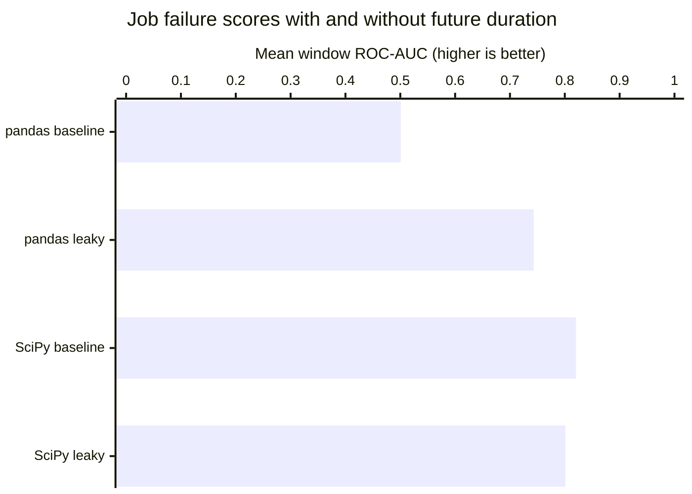
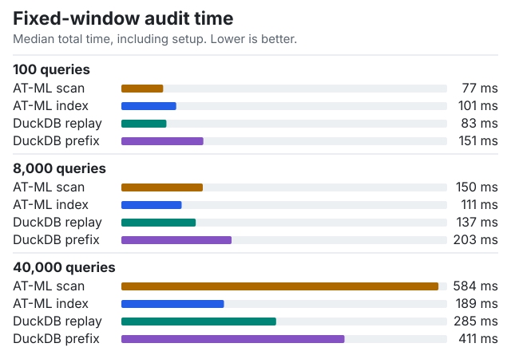

# Ante Tempus ML

In this synthetic example, a model predicts on November 10. It can see two transactions, \$20 and \$40, for a spending average of **\$30**. A later rebuild puts a **\$50** average under November 10 because it includes a \$90 transaction that did not arrive until November 30.

| Recorded availability of the \$50 update | As-of join selects | Source audit |
| --- | --- | --- |
| November 30, recorded correctly | Previous update, \$30 | All inputs were available. |
| November 10, backdated | Cutoff update, \$50 | `T3-v1` arrived too late. Replay gives \$30. |

Ante Tempus ML studies temporal leakage in ML pipelines. The join checks the feature's recorded availability. In the spending and scaler examples, the audit checks the input records and recomputes the feature at the cutoff.

Open the [HTML report](results/provenance.html) locally to inspect the records. No server needed.

## Experiments

| Study | What it checks |
| --- | --- |
| Spending and normalization | Unavailable transactions, late corrections, and future rows used to fit a scaler. |
| Validation | Full-data versus training-only preprocessing, and random versus forward splits on a synthetic time series. |
| Target-derived features | A timestamp can pass even when the feature encodes the outcome being predicted. |
| Real CI jobs | The model predicts job failure at startup, before the job's final duration is known. |
| Backdated spending | A join accepts a feature stamped at the cutoff. The source audit checks whether it used late transactions or revisions. |
| 30-day churn labels | Past tickets provide features. Future cancellations provide labels. Day 30 counts, but day 31 does not. Rows with incomplete follow-up stay unlabeled. |

### Backdated spending

In the [backfill experiment](results/churn-backfill.md), every transaction occurred before prediction. Some records arrived or were corrected afterward. The ordinary join trusts the backdated feature timestamp, while the source audit catches the unavailable inputs and reconstructs the spending average. The study uses 8,000 synthetic customers per seed, a 30% target churn rate, and five paired seeds. It compares retrospective scoring, historical replay, and retraining on historical inputs.

### Real CI jobs

The baseline uses the job name. The leaky run adds the current job's final duration, which is unknown at startup.



Adding duration raises AUC for pandas and lowers it for SciPy. It leaks in both cases.

## Fixed-window benchmark

The verifier returns the batch and historical sums and counts for a spending window. If a row arrived too late, it returns that row's ID. All four plans returned the same results. AT-ML index was fastest at 40,000 queries, but AT-ML scan was fastest at 100.



The [benchmark notes](docs/window-verifier.md#duckdb-baseline) include a text table, the second seed, and the command to rerun the comparison.

## Run locally

From the repository root, use `uv` with Python 3.12. The demo writes to `results/raw/` and leaves the checked-in report alone.

```sh
uv run --no-project --python 3.12 --with-editable . -- python -m ante_tempus_ml.provenance_report --out results/raw/demo.html
uv run --no-project --python 3.12 --with-editable . --with pytest --with pandas -- python -m pytest -q
```

<details>
<summary>Rebuild the report with real CI and timing data</summary>

Collecting CI snapshots needs `gh` with GitHub API access. The raw JSON and the rebuilt report stay in `results/raw/`, which Git ignores.

```sh
uv run --no-project --python 3.12 --with-editable . -- python -m ante_tempus_ml.ci_source --cohort pandas
uv run --no-project --python 3.12 --with-editable . -- python -m ante_tempus_ml.ci_source --cohort scipy
uv run --no-project --python 3.12 --with-editable . -- python -m ante_tempus_ml.window_bench
uv run --no-project --python 3.12 --with-editable . -- python -m ante_tempus_ml.provenance_report \
  --ci-jobs results/raw/ci-jobs.json --ci-jobs results/raw/ci-jobs-scipy.json \
  --window-bench results/raw/window-bench.json --out results/raw/rebuilt-report.html
```

The backfill experiment writes `results/raw/churn-backfill.md`:

```sh
uv run --no-project --python 3.12 --with-editable . -- python -m ante_tempus_ml.churn_backfill
```

</details>

## Scope

The source-record examples check known inputs. They do not trace arbitrary SQL or Python. The [fixed-window guarantee](docs/window-verifier.md#guarantee) covers one aligned average over immutable records. There is no streaming or online serving component.

<details>
<summary>Study methods and sources</summary>

**Point-in-time joins.** Each entity has a sorted timeline searched by availability. The join uses integer timestamps and supports a fixed ingestion delay or per-row availability, plus a freshness limit. Equal availability times favor the last input row. An empty feature table returns no matches. Tests check selected row indices against a brute-force scan and pandas.

**Validation.** The scaler study changes only the rows used to fit the scaler. Both arms use the same training labels and test rows. The time-series study uses the same nearest-neighbor classifier on equal-sized random and forward folds. Their scores come from different rows, so the gap alone does not measure leakage. The study refits the classifier on all development data before scoring the untouched future holdout. Both studies run five seeds.

**Target-derived features.** The synthetic build study compares a previous known result with a badge derived from the current build's outcome. It scores the same chronological holdout with the retrospective badge, with that badge replaced by zero at replay, and with a model trained without it.

**Real CI jobs.** The [GitHub Actions jobs API](https://docs.github.com/en/rest/actions/workflow-jobs) supplies start and completion timestamps from first-attempt PR runs. The two cohorts are [pandas Unit Tests](https://github.com/pandas-dev/pandas/actions/workflows/unit-tests.yml) on November 21-23, 2026, and [SciPy Linux tests](https://github.com/scipy/scipy/actions/workflows/linux.yml) on November 17-23, 2026. Dates are in UTC. Each arm scores the same successful or failed jobs with positive durations. The report also tests a third arm that adds the most recent eligible duration for the same job name.

Five chronological blocks yield four evaluation windows. Models train on jobs that finished before the cutoff. AUC includes windows with both outcomes. Log loss includes every scored job. The report keeps the cohorts separate and links to the original jobs. These two cohorts do not represent CI jobs in general.

**Prior work.** The [CI build leakage study](https://pmc.ncbi.nlm.nih.gov/articles/PMC13215522/), [formal leakage analysis](https://www.sciencedirect.com/science/article/pii/S0167642325000772), and [notebook slicing](https://conf.researchr.org/details/fse-2026/fse-2026-research-papers/177/Improving-Data-Leakage-Detection-in-Machine-Learning-Notebooks-through-Static-Slicing) informed the cases and checks. These experiments do not reproduce those papers.

</details>
