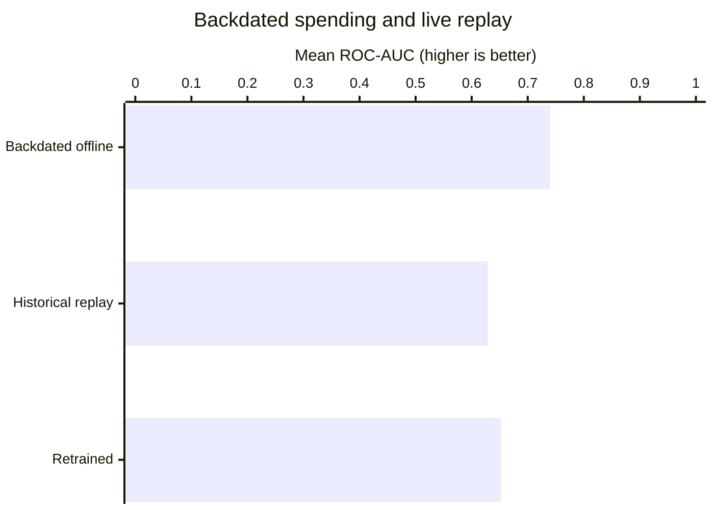

# Backdated spending features

Every transaction occurred before prediction. Some transaction records arrived or were revised later. A retrospective feature build used them anyway and kept the cutoff as its recorded availability.

Each seed has 8,000 users, a 30% marginal churn probability (actual mean: 30.26%), and a chronological 75/25 split. A 31-day gap separates the training and holdout cutoffs so training labels have time to settle. The same holdout is scored in every arm.

## Detection

There were 2,709 intentionally contaminated features across 10,000 holdout predictions.

| Check | Contaminated rows caught | Clean rows flagged |
| --- | ---: | ---: |
| Point-in-time join, backdated metadata | 0 / 2,709 | 0 / 7,291 |
| Point-in-time join, honest metadata control | 2,709 / 2,709 | 0 / 7,291 |
| Source audit, backdated metadata | 2,709 / 2,709 | 0 / 7,291 |

## Churn prediction

The model uses spending and an activity measure already available at prediction. Each model's scaler is fit only on its training rows. Replay feeds the retrospectively trained model the historically correct features; retraining uses those correct features in both training and scoring.

| Seed | Late arrivals | Late revisions | Backdated offline AUC | Replay AUC | Retrained AUC |
| ---: | ---: | ---: | ---: | ---: | ---: |
| 11 | 245 | 293 | 0.730 | 0.624 | 0.646 |
| 29 | 281 | 276 | 0.751 | 0.627 | 0.645 |
| 47 | 254 | 292 | 0.750 | 0.646 | 0.664 |
| 71 | 265 | 269 | 0.743 | 0.631 | 0.653 |
| 103 | 260 | 274 | 0.728 | 0.619 | 0.654 |
| Mean | | | 0.740 | 0.629 | 0.652 |

## Scope

This is a synthetic mechanism check. Late reconciliation is deliberately more likely for churners (60%) than non-churners (12%). The audit has complete input-version history. Neither the contamination rate nor the AUC gap estimates what happens in a real warehouse.
